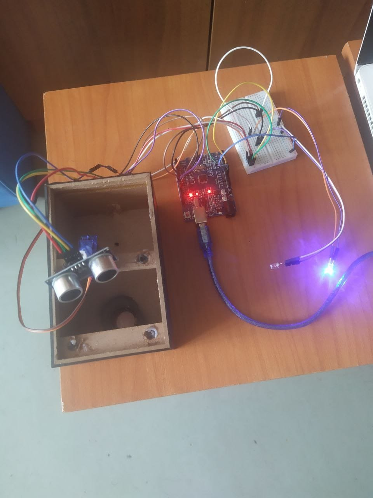
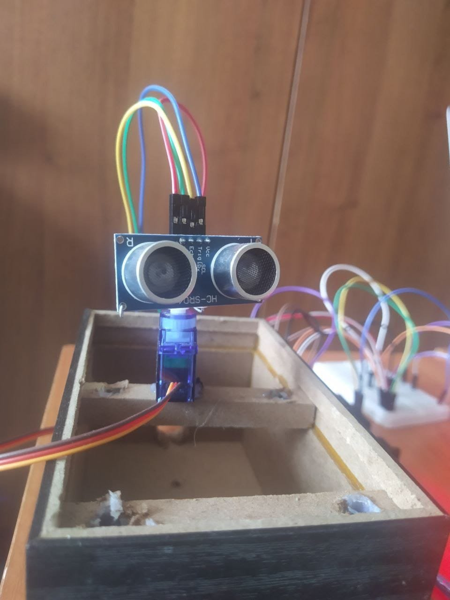
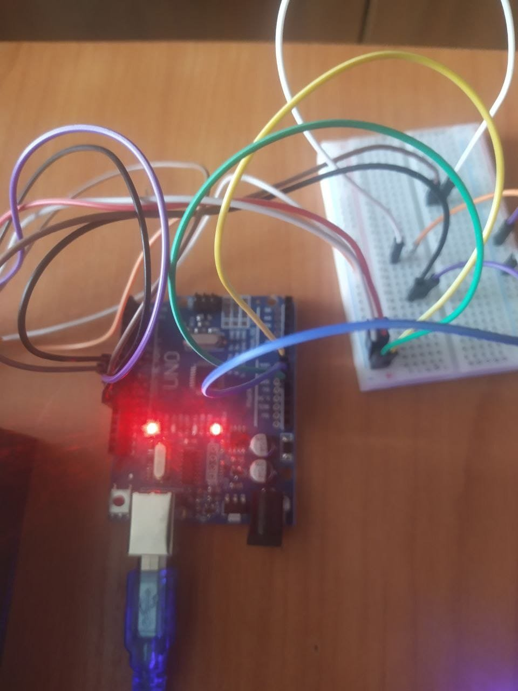
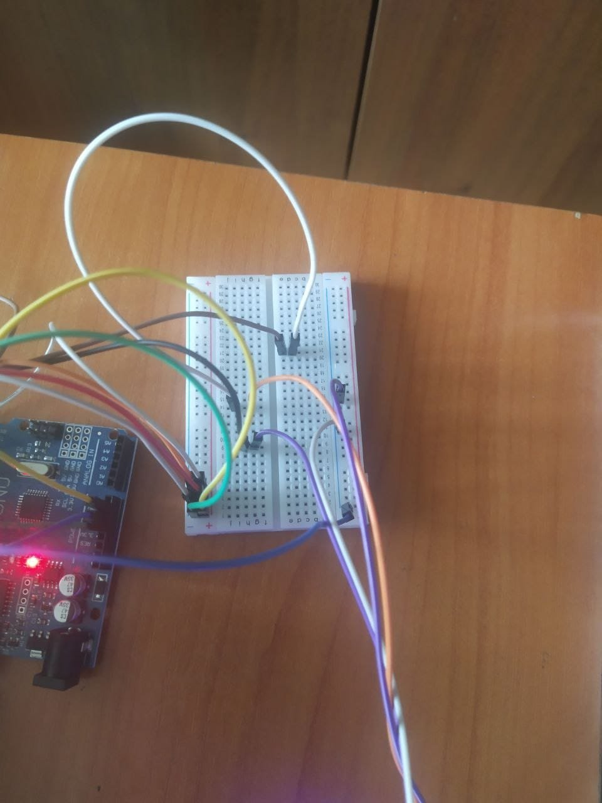
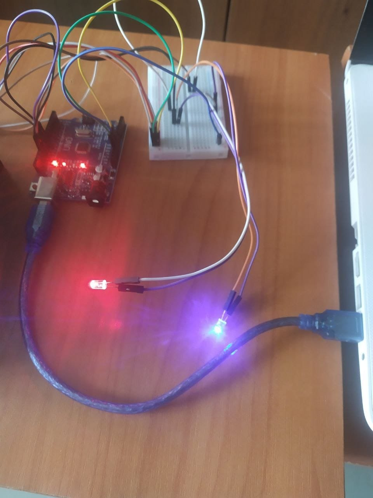

# Arduino Ultrasonic Radar

An Arduino radar that sweeps HC-SR04 ultrasonic sensors on servos, detects objects, and draws them live on a PC with Processing. It exists in two versions, and the repository shows how the first one grew into the second.

| Version | What it is | Who wrote the code |
| --- | --- | --- |
| [v1: single radar](v1-single-radar) | One sensor on one servo, two LEDs, a Processing radar screen | Based on **Nurlan Quluzade's Arduino radar tutorial**. Not my original code. |
| **v2: dual radar** (this folder, the main version) | Two sensors on two servos sweeping in opposite directions, per-sensor LEDs, a buzzer, two radar screens | **My own work**, built on what I learned from v1 |

## The story

I started in 2023 as part of my bachelor's graduation project (IT / networks, Voronezh State University). The goal was a small intrusion and moving-object detection demo for a protection system. I first built the single-sensor radar by following Nurlan Quluzade's tutorial, wired it on a breadboard, and used it in my thesis. That is v1, and it is credited to him in its folder and on its radar screen.

After the thesis I wanted to go further than the tutorial. I rewrote the Arduino and Processing code myself to run two sensors and two servos at once, added a buzzer and an LED per sensor, and added a new serial format and display so both sweeps are drawn together. That is v2.

## v1: single radar (tutorial base)

Built from Nurlan Quluzade's tutorial. Code and notes are in [`v1-single-radar/`](v1-single-radar).

### Photos of the build



| Sensor on servo | Arduino Uno wiring |
| --- | --- |
|  |  |

| Breadboard wiring | LEDs and breadboard |
| --- | --- |
|  |  |

### Demo video

<video src="https://github.com/user-attachments/assets/ec14cd08-14e6-439f-b61d-ce2d0009dcb7" controls width="360"></video>

Video not showing? [Open the file](media/demo-v1-single-radar.mp4) (full quality, 57 s).

This video shows the **v1 single radar** running. A v2 demo is still to come.

## v2: dual radar (my upgrade)

### What it does

- Two servos sweep two ultrasonic sensors through 0-180 degrees, in opposite directions.
- Each sensor measures distance with the HC-SR04 trigger/echo method.
- An object closer than **20 cm** turns that sensor's LED red and turns the buzzer on. Otherwise the LED is green.
- The Arduino sends the angle and distance of both sensors to the PC every 50 ms.
- The Processing sketch shows two radar screens, the detected points with a short trail, and a panel with the live angle and distance for each sensor.

### Repository layout

```
radar_arduino/radar_arduino.ino         v2 Arduino sketch (sensors, servos, LEDs, buzzer, serial output)
radar_processing/radar_processing.pde   v2 Processing sketch (dual radar display)
v1-single-radar/                        v1 single radar, based on Nurlan Quluzade's tutorial
images/                                 Build photos (v1 hardware)
media/                                  Demo video (v1 running)
```

Each sketch is in a folder with the same name, as the Arduino IDE and Processing expect.

### Hardware

- Arduino board (Uno or compatible)
- 2 x HC-SR04 ultrasonic sensors
- 2 x hobby servo motors (one carries each sensor)
- 2 x green LEDs and 2 x red LEDs (with series resistors)
- 1 x buzzer (driven directly from a digital pin)
- Jumper wires, breadboard, external 5 V supply for the servos if the board's 5 V is not enough
- USB cable to the PC

### Wiring (pins used in the sketch)

| Part | Arduino pin |
| --- | --- |
| Sensor 1 TRIG | D2 |
| Sensor 1 ECHO | D3 |
| Sensor 2 TRIG | D4 |
| Sensor 2 ECHO | D5 |
| Servo 1 signal | D6 |
| Servo 2 signal | D7 |
| Sensor 1 green LED | D8 |
| Sensor 1 red LED | D9 |
| Sensor 2 green LED | D10 |
| Sensor 2 red LED | D11 |
| Buzzer | D12 |

Power the sensors from 5 V and share a common ground between the Arduino, sensors, servos, LEDs and buzzer.

### How the two parts talk over serial

The Arduino prints one line every 50 ms at **115200 baud**, in this format:

```
angle1,distance1,angle2,distance2.
```

Example: `90,34,90,0.` means sensor 1 is at 90 degrees and sees an object 34 cm away, and sensor 2 is at 90 degrees with nothing in range. A distance of `0` means no echo (nothing detected).

The line ends with a full stop `.`. The Processing sketch reads up to that character, splits the text on commas, and checks that it got four values before using them.

### How to run it

1. Wire the hardware as in the table above.
2. Open `radar_arduino/radar_arduino.ino` in the Arduino IDE (the `Servo` library is included with the IDE), select your board and port, and upload.
3. Close the Arduino Serial Monitor so the port is free.
4. Open `radar_processing/radar_processing.pde` in [Processing](https://processing.org/) (it uses the built-in `processing.serial` library).
5. The sketch opens `COM3` at 115200 baud. If your Arduino is on a different port, change `"COM3"` in `setup()`.
6. Run the sketch. Press the space bar to clear the trail of detected points.

### Display notes

- The radar display scales 0-200 cm to the radar radius. Objects farther than 200 cm are not drawn.
- Sensor 1 is drawn in red and sensor 2 in blue.
- The buzzer/LED alert distance is set by `objectThreshold` (20 cm) in the Arduino sketch.

## Possible improvements

- Pick the serial port automatically instead of hard-coding `COM3`.
- Log detections with a timestamp.
- Add a larger display range and a configurable alert distance.
- Add photos and a demo video of the v2 hardware.

## Credits

- v1 single radar: based on Nurlan Quluzade's Arduino radar tutorial.
- v2 dual radar: Asad Moursi.

## Author

Asad Moursi, IT and networking graduate, Cairo, Egypt.
